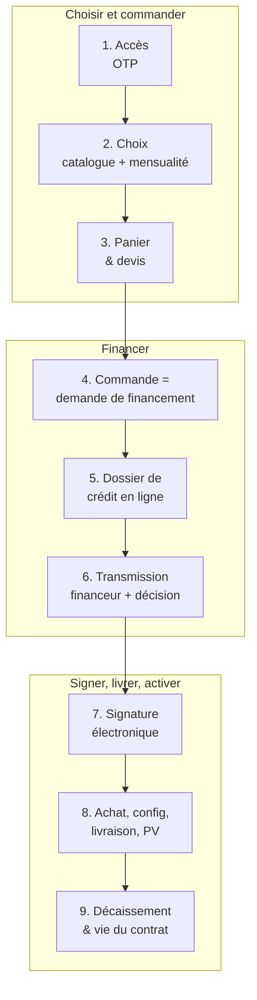
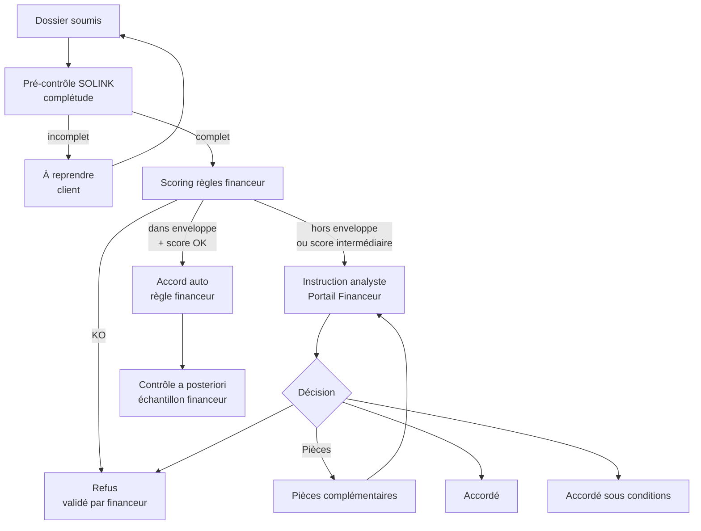
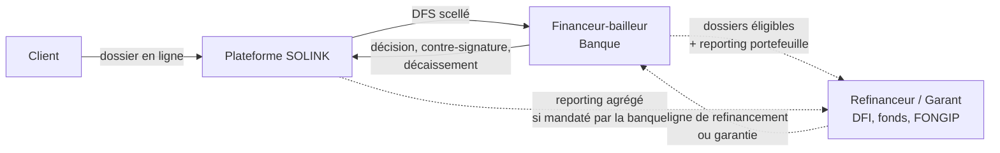
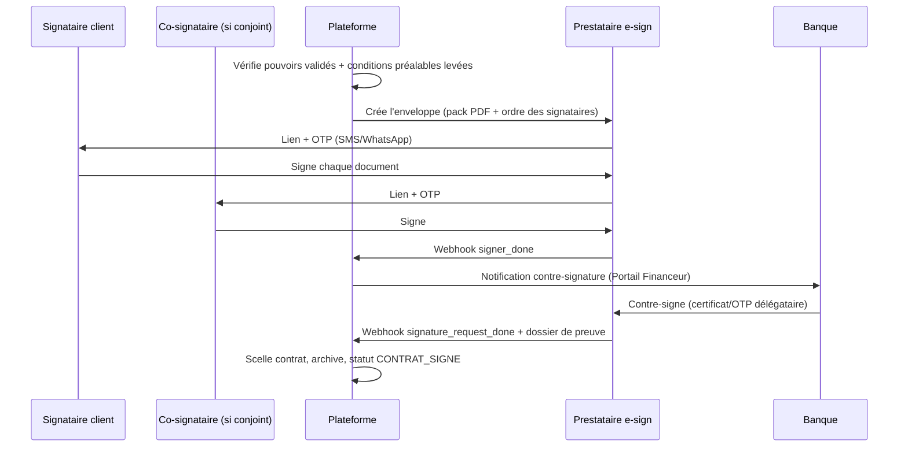
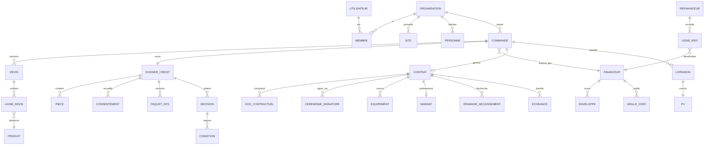
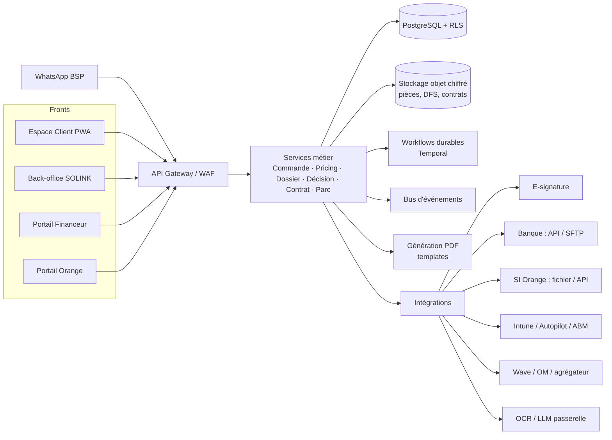

# Spécifications Plateforme SOLINK DaaS — v4.0

> **Version 4.0 — 05/11/2026** — Refonte de la v3 centrée sur le **parcours client digital complet** et la **chaîne de financement**.
> Sources analysées : `Specs_Plateforme_DaaS_SOLINK_v3` (.md/.docx), deck `Modele_DaaS_Montage2_SOLINK_Orange.pptx`, `fleet_tech_stack.md`, bundle back-office Fleet `fleet-admin-index.js` (statuts commande, types de pièces, enveloppes, scoring bailleurs, motifs de fin de contrat).
> Conventions : **[H]** hypothèse à valider · **[À définir]** paramètre non chiffré (aucun chiffre inventé) · **[Avis juridique]** point à faire valider par avocat/fiscaliste.
> Devise XOF (FCFA, sans décimales) · Fuseau Africa/Dakar (UTC+0) · Langue FR (EN en P1).

---

## 0. Ce qui change par rapport à la v3

La v3 était un **catalogue de 22 modules** très complet mais à plat : elle décrivait *ce que la plateforme contient*, pas *ce que vit le client minute par minute*. Elle laissait aussi trois trous majeurs : le dossier de crédit n'était pas spécifié au niveau champ/pièce, la transmission au partenaire financier se résumait à « SFTP », et la signature n'avait ni séquence ni gestion des pouvoirs. La v4 corrige cela.

| Sujet | v3 | v4 |
|---|---|---|
| Colonne vertébrale | 22 modules juxtaposés | **Un parcours unique en 9 étapes** (§4), chaque module est rattaché à une étape |
| UX client | « ≤ 5 écrans » (objectif) | **Spécification écran par écran** (E01–E24) avec règles et critères d'acceptation (§5) |
| Tarification | Formule additive | **Méthode coefficient × prix d'achat** par financeur/durée (pratique bailleurs), verrouillage du prix, validité du devis (§6) |
| Dossier de crédit | Liste de pièces KYC | **Dossier structuré** : 5 blocs, checklist dynamique par segment, statut par pièce, bénéficiaires effectifs, consentements BIC (§7) |
| Décision | Enveloppe + analyste | **3 voies** (auto enveloppe / instruction financeur / refus pré-filtre), accord sous conditions, conditions suspensives, durée de validité (§7.6) |
| Partenaire financier | « Import SFTP » | **Dossier de Financement Standardisé (DFS)** scellé + **Portail Financeur** + **API Financeur** + couche **Refinanceur** (§8) |
| Signature | « E-sign + annexes » | **Cérémonie de signature** : pack contractuel, ordre des signataires, vérification des pouvoirs, contre-signature banque, mandat de prélèvement, dossier de preuve (§9) |
| États | 3 machines séparées | **Machine à états unifiée de la commande** (27 états, propriétaire, SLA, libellé client) (§10) |
| Paiement SOLINK | « au PV » | **Demande de décaissement** générée automatiquement (facture + PV + séries + photos) et suivie (§11.2) |
| Fleet | Mapping marketing | Mapping enrichi par le **code réel** du back-office Fleet (Annexe D) |
| Périmètre MVP | 4 agents + 15 modules | **MVP recentré** sur le parcours de bout en bout ; agents IA limités à l'assistance (§19) |

---

## 1. Résumé exécutif

SOLINK construit **la plateforme qui permet à une entreprise sénégalaise d'équiper ses collaborateurs en postes de travail managés, financés par une banque, en ligne et sans papier** :

1. Le client **se connecte** (OTP, sans mot de passe), **choisit** ses équipements et services dans un catalogue (Bureau cloud, Poste mobile, Hybride) avec une **mensualité affichée en temps réel**.
2. Il **passe commande** : son panier devient un devis puis une **demande de financement**.
3. Il **monte son dossier de crédit en ligne** : informations pré-remplies (NINEA/RCCM, OCR), pièces téléversées depuis le mobile, consentements, suivi pièce par pièce.
4. Le dossier est **scellé et transmis au partenaire financier** (banque bailleur, et le cas échéant son refinanceur) via un portail dédié ou une API ; la décision revient dans la plateforme.
5. Le client **signe en ligne** son contrat de location financière, ses annexes et son mandat de prélèvement ; la banque contre-signe.
6. SOLINK achète, configure (Autopilot/Intune), livre ; le **PV de livraison signé** déclenche automatiquement la **demande de décaissement** à la banque (paiement SOLINK 100 %).
7. Le cycle de vie suit : facture Orange unique à 2 lignes, cantonnement, support, recouvrement, retour A–E, reconditionnement.

**Ce que la plateforme n'est pas** (inchangé, non négociable) : ni établissement de crédit, ni établissement de paiement. Elle **ne détient jamais de fonds** et **ne prend jamais la décision de crédit** : elle prépare, transmet, trace et exécute. La banque est **bailleur et propriétaire** ; Orange Business est **apporteur et mandataire de facturation** ; SOLINK est **fournisseur-opérateur**.

**Hypothèse de lecture [H] — « partenaire financier ».** La demande mentionne « le partenaire financier qui va apporter le financement à la banque ». La v4 modélise donc **deux niveaux** :
- le **Financeur-bailleur** (Coris / CBAO au pilote) : instruit, décide, signe, possède, décaisse ;
- un **Refinanceur** optionnel (DFI, fonds, ligne de refinancement, garant de portefeuille) qui **apporte la liquidité ou la garantie à la banque** et reçoit un reporting portefeuille et, selon le montage, les dossiers individuels.
Si le pilote n'a qu'une banque sans refinanceur, la couche Refinanceur reste inactive sans impact sur le parcours.

---

## 2. Périmètre et principes

### 2.1 Dans le périmètre (v4)
- Front client complet : accès, catalogue, configurateur, panier, devis, commande, dossier de crédit, suivi, signature, livraison, espace client.
- Back-office SOLINK : pré-instruction, achats, logistique, PV, décaissement, parc, support, retours.
- **Portail Financeur** (banque) et **Portail Refinanceur** (lecture portefeuille).
- **Portail Orange** (co-selling, apport, commissions, export facturation).
- API Financeur + webhooks ; API plateforme (P1).

### 2.2 Hors périmètre (inchangé)
Comptabilité légale (export SYSCOHADA seulement), paie, détention de fonds, décision de crédit, MDM propriétaire, prestataire de signature (on intègre un prestataire).

### 2.3 Principes de conception

| # | Principe | Conséquence concrète |
|---|---|---|
| P1 | **Le parcours avant les modules** | Toute fonctionnalité est rattachée à une étape du parcours §4 ; si elle n'en a pas, elle n'est pas MVP |
| P2 | **Montage 2 respecté à chaque écran** | Rôles banque / Orange / SOLINK visibles ; jamais de flux d'argent via SOLINK |
| P3 | **Mensualité visible en permanence** | Le client voit son coût mensuel TTC tout compris dès la 1re interaction, avec détail dépliable |
| P4 | **Saisir une fois, réutiliser partout** | NINEA/RCCM, dirigeants, adresses, pièces : saisis une fois, réutilisés pour devis, dossier, contrat, facture, renouvellement |
| P5 | **Mobile-first, 3G, WhatsApp** | Photo de pièce depuis le téléphone, reprise de session par lien WhatsApp, pages < 300 Ko |
| P6 | **Transparence du statut** | Chaque état a un libellé client, un responsable, un délai cible et une prochaine action |
| P7 | **Dossier scellé, preuve banque-grade** | Toute transmission est un paquet versionné, horodaté, hashé ; tout événement est dans un journal chaîné |
| P8 | **L'IA assiste, l'humain décide** | Pré-remplissage, contrôle de complétude, synthèse ; jamais d'accord, de signature ou de mouvement de fonds |
| P9 | **Multi-financeurs par construction** | `financeur_id` sur toute commande, grille, enveloppe, contrat ; un seul financeur actif au pilote |

---

## 3. Acteurs, rôles et portails

### 3.1 Cinq portails, une seule API

| Portail | Utilisateurs | Finalité |
|---|---|---|
| **Espace Client** (web PWA + WhatsApp) | Administrateur client, Signataire, Responsable financier, Approbateur interne, Employé | Choisir, commander, monter le dossier, signer, suivre, gérer le parc |
| **Back-office SOLINK** | Commercial, Chargé de dossier (pré-instruction), Achats, Logistique, Technicien MDM, Support, Finance, Admin plateforme | Opérer le parcours et le parc |
| **Portail Financeur** | Analyste crédit, Valideur (délégation), Back-office crédit, Trésorerie, Risk officer | Instruire, décider, contre-signer, décaisser, piloter le portefeuille |
| **Portail Refinanceur** [H] | Chargé d'investissement, Risk | Suivre le portefeuille refinancé/garanti, recevoir les dossiers éligibles, reporting |
| **Portail Orange** | Commercial Orange (co-seller), Manager, Facturation | Apporter des leads, suivre, commissions, export facturation 2 lignes |

### 3.2 Rôles côté client (inspiré du modèle de rôles Fleet : *admin, signatory, finance, employee*)

| Rôle client | Peut | Ne peut pas |
|---|---|---|
| **Administrateur** | Inviter des membres, gérer sites, catalogue interne, commander, remplir le dossier | Signer s'il n'a pas les pouvoirs |
| **Signataire habilité** | Signer devis, contrat, mandat, PV ; ses pouvoirs sont **justifiés** par une pièce (statuts/PV/délégation) | Modifier le dossier après scellement |
| **Responsable financier** | Remplir le bloc Finances, téléverser états financiers, suivre échéancier et factures | Inviter des admins |
| **Approbateur interne** (optionnel) | Approuver un panier au-delà d'un seuil interne défini par le client | — |
| **Réceptionnaire site** | Signer le PV de livraison de son site | Voir les conditions financières |
| **Employé** (P1) | Voir son équipement, ouvrir un ticket, demander un équipement dans la liste pré-approuvée | Voir prix et contrats |

Un même utilisateur peut cumuler plusieurs rôles. Le **signataire** est un rôle juridique : la plateforme vérifie qu'une pièce de pouvoir a été validée avant d'ouvrir la signature (§9.3).

### 3.3 Matrice d'accès (synthèse — L lecture, E écriture, V validation, S signature)

| Objet | Client admin | Signataire | Fin. client | SOLINK | Orange | Financeur | Refinanceur |
|---|---|---|---|---|---|---|---|
| Catalogue & prix | L | L | L | E | L | L (grilles : E) | — |
| Panier / devis | E | S (acceptation) | L | E | L (ses apports) | — | — |
| Dossier de crédit | E | L | E | L + pré-contrôle | Statut seul | L + V | L si éligible [H] |
| Pièces justificatives | E | E | E | L (statut : E) | — | L (statut : E) | L (DFS) [H] |
| Décision crédit | L (résultat + conditions) | L | L | L | Statut seul | **E** | L |
| Contrat & annexes | L | **S** | L | E (génération) | L | **S** (contre-signature) | L |
| Mandat de prélèvement | L | **S** | L | L | L | L | — |
| PV livraison | L | S | L | E | L | L | L |
| Demande de décaissement | — | — | — | E | L | **V** (paiement) | L |
| Parc / équipements | L | L | L | E | L | L (propriétaire) | Agrégé |
| Factures / échéancier | L | L | L | L | **E** (émission) | L | Agrégé |
| Cantonnement | L (siens) | — | L | L (sa part) | L (sa part) | **E** | Agrégé |
| Enveloppes & grilles | — | — | — | L | — | **E** | L |
| Journal d'audit | — | — | — | L | L (son périmètre) | L (son périmètre) | L (son périmètre) |

Cloisonnement : **par organisation cliente (tenant)**, **par financeur** et **par apporteur** (Row-Level Security PostgreSQL).


---

## 4. Le parcours client cible (colonne vertébrale)

### 4.1 Vue d'ensemble en 9 étapes



| Étape | Ce que fait le client | Ce que fait la plateforme | Acteur pivot | Délai cible [À définir avec pilote] |
|---|---|---|---|---|
| 1. Accès | Saisit email/mobile, reçoit un code | Crée le compte, rattache l'entreprise via NINEA | Client | < 2 min |
| 2. Choix | Parcourt les offres, compare, simule durée/options | Calcule la mensualité selon la grille du financeur | Client | < 10 min |
| 3. Panier & devis | Répartit par sites, valide en interne | Génère devis PDF signé électroniquement par SOLINK, validité X jours | Client / SOLINK | Immédiat |
| 4. Commande | Clique « Demander le financement » | Gèle le prix, ouvre le dossier, pré-remplit | Client | Immédiat |
| 5. Dossier | Complète 5 blocs, téléverse les pièces, donne ses consentements | OCR + contrôle de complétude + pré-contrôle SOLINK | Client / SOLINK | 1–3 j |
| 6. Décision | Suit le statut, répond aux demandes de pièces | Scelle et transmet le DFS ; route vers accord auto ou analyste | Financeur | Auto : < 1 h ouvrée ; analyste : [À définir] |
| 7. Signature | Lit l'offre, signe contrat + annexes + mandat, paie le dépôt | Ordonne les signatures, vérifie les pouvoirs, contre-signature banque | Client / Financeur | < 48 h |
| 8. Livraison | Choisit les créneaux, signe le PV par site | Achat, Autopilot, logistique, PV numérique | SOLINK | [À définir : stock vs import] |
| 9. Vie du contrat | Gère son parc, paie sa facture Orange, ouvre des tickets | Demande de décaissement, facturation 2 lignes, cantonnement, support | Tous | Mensuel |

### 4.2 Les trois « chemins » d'entrée

| Chemin | Déclencheur | Particularité |
|---|---|---|
| **Self-service** | Le client arrive seul (site, campagne) | Parcours complet, pas d'intermédiaire |
| **Apporté par Orange** | Un commercial Orange crée le lead et envoie une **invitation pré-remplie** (entreprise, contact, besoin) | Attribution apporteur automatique (commission), le commercial voit le statut sans voir les pièces |
| **Assisté SOLINK** | Un commercial SOLINK construit le panier **avec** ou **pour** le client (mode « co-navigation ») | Le client reprend la main pour valider le devis, remplir le dossier et signer — il ne peut jamais être signé « pour » lui |

### 4.3 Règle d'or « jamais bloqué »
À chaque instant, l'écran d'accueil client affiche **une seule prochaine action** (« Ajoutez l'attestation fiscale », « Signez le contrat », « Choisissez votre créneau de livraison ») avec son responsable et son délai. Si l'action dépend d'un tiers (banque, SOLINK), l'écran le dit et donne l'heure de la dernière mise à jour.

---

## 5. Spécification écran par écran (Espace Client)

Format : **objectif · contenu · règles · critères d'acceptation (CA)**. Les identifiants `E..` servent de référence pour les maquettes et les tickets.

### 5.1 Accès et onboarding

**E01 — Page d'accueil publique**

- Objectif : convertir. Promesse, 3 offres (BC / PM / HY), mensualité « à partir de » (calculée, jamais saisie à la main), logos partenaires (Orange, banque — sous réserve d'accord), bouton « Configurer mon équipement » (sans compte) et « Me connecter ».
- Règle : le configurateur est accessible **sans compte** ; le compte n'est demandé qu'au moment d'enregistrer le panier.

**E02 — Connexion / inscription sans mot de passe**

- Saisie email **ou** numéro mobile (+221) → code OTP 6 chiffres (SMS, WhatsApp ou email selon le canal choisi), validité 10 min, 5 tentatives.
- Option SSO **Microsoft Entra ID** / Google pour les entreprises sous M365 (P1).
- CA : un utilisateur invité par lien (Orange/SOLINK/admin) arrive directement connecté sur l'entreprise pré-remplie après OTP.

**E03 — Identification de l'entreprise**

- Saisie **NINEA** (ou RCCM) → pré-remplissage raison sociale, forme juridique, adresse si une source est disponible **[H : source NINEA/RCCM à identifier — à défaut, saisie manuelle + contrôle sur pièce]**.
- Segment demandé : *Grande entreprise / PME / Institution financière / Administration-établissement public / ONG-organisation internationale*. Le segment pilote la checklist du dossier (§7.3).
- Détection de doublon : si le NINEA existe déjà, demande d'accès à l'administrateur existant (pas de second tenant).

**E04 — Équipe et rôles**

- Invitation de membres (email/mobile) avec rôle(s) §3.2. Désignation du ou des **signataires** (nom, fonction, mode de signature : seul / conjoint).
- CA : impossible de terminer le dossier sans au moins un signataire désigné.

**E05 — Sites de livraison**

- Liste des sites (siège, agences) avec adresse, repère, géolocalisation (pin carte), contact réceptionnaire, horaires. Import CSV pour > 10 sites.

### 5.2 Catalogue et configurateur

**E06 — Choix de l'offre**

- Trois cartes : **Bureau cloud** (thin client + Virtualisation des postes Orange), **Poste mobile** (laptop managé M365/Intune), **Hybride**. Chaque carte : pour qui, ce qui est inclus, mensualité « à partir de ».
- Assistant « Aidez-moi à choisir » (3 questions : métier, mobilité, applications) → recommandation d'offre et de gamme (règles déterministes ; l'IA reformule seulement).

**E07 — Catalogue produits**

- Filtres : offre, gamme (Essential / Pro / Premium), marque, usage, disponibilité (**En stock Dakar** / Sur commande + délai), AI-ready, clavier (AZERTY par défaut).
- Carte produit : photo, 4 caractéristiques clés, **mensualité TTC** pour la durée sélectionnée, délai de livraison.
- Règle : le prix d'achat et la marge **ne sont jamais affichés** ; seule la mensualité (et son détail en composantes) l'est.

**E08 — Fiche produit / configurateur**

- Choix : configuration (RAM/stockage parmi les variantes du catalogue), **durée 24 ou 36 mois** [paramétrable], assurance (incluse/option), services (support niveau, MDM, M365/Copilot, VDI Orange), accessoires (écran, dock, sacoche, casque).
- Bloc **« Votre mensualité »** toujours visible : total TTC/mois/poste, détail dépliable (loyer matériel · services SOLINK · services Orange · assurance · TVA), total du contrat, rappel « propriété de la banque, restitution en fin de contrat ».
- CA : tout changement d'option recalcule la mensualité en < 300 ms (calcul côté serveur, cache client).

**E09 — Packs par profil (catalogue interne client)**

- L'administrateur peut créer des **packs** (« Guichetier = BC t640 + écran 24'' + VDI Standard ») et les commander par quantité. Base des listes pré-approuvées employé (P1).

**E10 — Comparateur**

- Jusqu'à 3 produits côte à côte (caractéristiques + mensualité + délai).

### 5.3 Panier et devis

**E11 — Panier**

- Lignes produit/pack × quantité × **site de livraison** (un panier peut couvrir plusieurs sites).
- Totaux : mensualité TTC totale, nombre de postes, dépôt de garantie estimé [paramétrable], premier loyer estimé.
- Code apporteur Orange visible si le panier est apporté.
- Sauvegarde automatique ; partage du panier à un collègue (lien) ; « Demander un rappel » (création d'une tâche commerciale).

**E12 — Devis**

- Génération instantanée d'un **devis PDF** numéroté (`DV-AAAA-NNNNN`), daté, avec **date de validité** [À définir, ex. 15 jours — liée à la validité des coefficients du financeur et des prix distributeurs], conditions générales en lien, mentions Montage 2 (« bailleur : [banque] ; facturation : Orange Business pour compte »).
- **Circuit d'approbation interne client** (optionnel) : si mensualité totale > seuil défini par l'admin client → approbateur notifié, approuve/refuse avec commentaire.
- Actions : télécharger, partager WhatsApp/email, modifier (nouvelle version `DV-…-v2`), **accepter**.
- CA : un devis expiré ne peut pas être accepté ; il peut être « réactualisé » (nouveau calcul aux conditions du jour, le client voit l'écart).

### 5.4 Commande

**E13 — Récapitulatif de commande et demande de financement**

- Écran unique : lignes, sites, durée, mensualité, dépôt, documents qui seront à signer, **ce qui va se passer ensuite** (frise des 5 étapes restantes).
- Cases obligatoires : acceptation des CGU plateforme ; **consentement au traitement des données pour l'étude de financement** (transmission au financeur nommé, et au refinanceur/garant s'il y en a — nommés) ; consentement à la **consultation du BIC** (Creditinfo VoLo) par le financeur [Avis juridique sur la forme du consentement BIC].
- Bouton : **« Demander le financement »** → crée la Commande `CMD-AAAA-NNNNN`, **gèle les prix** pendant la validité du devis, ouvre le dossier de crédit pré-rempli.
- CA : le clic crée en une transaction : Commande, DossierCredit, Consentements horodatés (IP, user-agent, version du texte), événement d'audit.

### 5.5 Dossier de crédit en ligne

**E14 — Tableau de bord du dossier**

- Barre de progression par **bloc** (§7.2) : Entreprise · Dirigeants & bénéficiaires effectifs · Finances · Pièces justificatives · Consentements & déclarations.
- Chaque pièce affiche un statut (modèle Fleet `EMPTY / TO_EXAMINE / ACCEPTED / REFUSED`, francisé) : **À fournir · En vérification · Validée · À reprendre (motif)** · *Non applicable* (justifié).
- Bouton « Inviter un collègue à compléter » (ex. le DAF pour les états financiers) avec accès limité au bloc.

**E15 — Bloc Entreprise** : identité, NINEA, RCCM, date de création, capital, forme, siège, activité (code NAEMA [H]), effectif, banques actuelles, groupe d'appartenance.

**E16 — Bloc Dirigeants, signataires & bénéficiaires effectifs**

- Dirigeants légaux, signataires (avec la pièce établissant leurs pouvoirs), **bénéficiaires effectifs** (détention ≥ seuil réglementaire [Avis juridique — référence LCB-FT UEMOA]), statut PPE (personne politiquement exposée) déclaratif.
- Pièce d'identité : photo recto/verso depuis mobile → OCR → champs pré-remplis à confirmer.

**E17 — Bloc Finances**

- Saisie guidée de 6 à 10 agrégats par exercice (CA, résultat d'exploitation, résultat net, capitaux propres, dettes financières, trésorerie…) pour les **2 ou 3 derniers exercices** [selon segment], **ou** téléversement de la liasse SYSCOHADA/DSF avec extraction automatique proposée → validation par le client.
- Engagements en cours (crédits, leasings) déclaratifs.
- Ratios calculés et affichés **au client à titre informatif uniquement** si le financeur l'autorise [H].

**E18 — Bloc Pièces justificatives** : checklist dynamique (§7.3), glisser-déposer, photo mobile, multi-pages, détection de flou/recadrage, **contrôle de cohérence** (le NINEA sur l'attestation = NINEA déclaré ; date de l'extrait RCCM < 3 mois…). Réutilisation des pièces encore valides d'un dossier précédent (renouvellement, extension de parc).

**E19 — Bloc Consentements & déclarations** : exactitude des informations, consentements (rappel E13), déclaration PPE, acceptation de l'échange de données avec Orange (historique de paiement, si utilisé en scoring [Avis juridique]).

**E20 — Soumission**

- Bouton actif seulement si toutes les pièces obligatoires sont *En vérification* ou *Validées*.
- La soumission **scelle** une version du dossier (§8.2). Toute modification ultérieure crée une nouvelle version, tracée.

### 5.6 Suivi de la décision

**E21 — Suivi**

- Frise de statut (§10) avec libellés client ; **demandes de pièces complémentaires** du financeur affichées comme des tâches (« La banque demande : relevés bancaires des 6 derniers mois — avant le JJ/MM »), réponse en un clic.
- Messagerie liée au dossier (client ↔ chargé de dossier SOLINK ; le financeur passe par SOLINK au MVP, en direct en P1 [H]).
- Résultat : **Accordé** · **Accordé sous conditions** (liste des conditions, ex. dépôt majoré, caution du dirigeant, durée réduite) · **Refusé** (motif générique ; le motif détaillé reste chez le financeur).
- En cas d'accord sous conditions modifiant le prix, le client **accepte la nouvelle offre** (nouveau récapitulatif) avant la signature.

### 5.7 Signature

**E22 — Offre de financement et cérémonie de signature**

- Récapitulatif : bailleur, durée, mensualité, échéancier, dépôt, assurance, conditions, liste des documents (§9.1) consultables avant signature.
- Ordre de signature affiché (« 1. Vous · 2. M. X (co-signataire) · 3. Banque »).
- Signature par OTP SMS/WhatsApp (niveau avancé) via le prestataire intégré ; chaque document signé est horodaté.
- **Mandat de prélèvement** : choix du moyen (prélèvement bancaire / Wave / Orange Money [selon disponibilité au pilote]) et signature.
- **Dépôt de garantie** : paiement vers le **compte désigné par la banque** (virement avec référence unique, ou agrégateur réglant directement la banque) — **jamais vers SOLINK** [Avis juridique].
- CA : la contre-signature banque n'est sollicitée qu'après la dernière signature client ; le contrat n'est « en vigueur » qu'après contre-signature **et** levée des conditions suspensives (§9.4).

### 5.8 Livraison

**E23 — Livraison et PV**

- Choix des créneaux par site (après « Prêt à expédier ») ; suivi (préparé, configuré, en route, livré).
- **PV numérique par site** sur tablette/mobile du livreur ou lien envoyé au réceptionnaire : liste des numéros de série, photos, réserves éventuelles, signature OTP du réceptionnaire.
- Réserve bloquante (casse, manquant) → ticket automatique, PV partiel possible [H : le financeur accepte-t-il un décaissement partiel ?].

### 5.9 Après activation

**E24 — Espace parc et contrat** (reprise v3 MOD-CLI-007 enrichie)

- Parc par site et par collaborateur ; état MDM ; documents ; **échéancier** ; factures Orange ; tickets ; **renouvellement** proposé à J-120 ; ajout de postes (« extension de parc » = nouveau mini-dossier allégé si dans l'encours autorisé).


---

## 6. Moteur de tarification et simulation

### 6.1 Méthode : coefficient bailleur × prix d'achat
La pratique des bailleurs (observée dans le back-office Fleet : coefficient mensuel par bailleur et par durée, en % du prix d'achat) est plus simple à faire valider par une banque qu'une formule actuarielle. La v4 l'adopte.

```
Loyer_matériel_HT/mois (siège i) = Base_financée_i × Coef(financeur, durée, gamme, VR) / 100

Base_financée_i = Prix_achat_HT_distributeur_i
                + Frais_logistique_et_douane_i
                + Frais_setup_SOLINK_i (Autopilot, gravure, étiquetage)
                + Marge_SOLINK_matériel_i

Mensualité_HT_i = Loyer_matériel_HT_i
                + Services_SOLINK_HT_i (support, MDM, gestion de parc)
                + Services_Orange_HT_i (VDI, connectivité, licences revendues)
                + Assurance_HT_i
                + Addons_HT_i

Mensualité_TTC_i = Mensualité_HT_i × (1 + TVA_applicable_par_ligne)
```

- **Grille de coefficients** : saisie et versionnée par le **financeur** dans son portail (table `GrilleCoefficient` : financeur, durée, gamme/catégorie, valeur résiduelle %, tranche de montant, date d'effet, date de fin). Aucune valeur n'est fixée dans ce document **[À définir avec la banque]**.
- **TVA** : taux applicable et traitement de la facture « pour compte » d'Orange **[Avis fiscaliste]** ; le moteur gère une TVA **par ligne** pour permettre la facture à 2 lignes.
- **Arrondi** : calcul en précision décimale, arrondi final à l'**unité FCFA** par ligne et par poste ; la somme des postes = total affiché (écart d'arrondi porté sur la dernière ligne, documenté).
- **Commission Orange** et **marge banque** : intégrées dans les composantes (jamais affichées au client), paramétrées par contrat-cadre.

### 6.2 Verrouillage du prix
| Moment | Statut du prix |
|---|---|
| Configurateur, panier | Indicatif, recalculé à chaque affichage |
| Devis émis | **Garanti jusqu'à la date de validité** (prix distributeur + grille du financeur figés dans le devis) |
| Demande de financement | Gel prolongé jusqu'à la décision si dossier soumis avant expiration [Règle à valider avec la banque] |
| Accord | Prix définitif ; seul un « accord sous conditions » peut le modifier, avec nouvelle acceptation client |
| Signature | Prix contractuel |

### 6.3 Paramètres administrables
`coefficients` (financeur) · `valeur_residuelle_%` (financeur) · `durées_autorisées` · `dépôt_%` · `marge_SOLINK_%` par gamme · `forfaits_services` · `tarifs_VDI_Orange` · `prime_assurance` · `commission_apporteur` · `validité_devis_jours` · `seuil_approbation_interne` (client) — **tous [À définir]**, versionnés, avec double validation (SOLINK + financeur pour ce qui le concerne).

### 6.4 Simulation inverse
« J'ai un budget de X FCFA/mois » → la plateforme propose les combinaisons offre × gamme × durée qui tiennent dans le budget (P1).

---

## 7. Le dossier de crédit

### 7.1 Objectif
Produire, en ligne et en moins de 3 jours ouvrés côté client, un dossier **complet du premier coup** que le financeur peut instruire **sans reprise papier**.

### 7.2 Structure en 5 blocs

| Bloc | Contenu | Source principale | Réutilisable |
|---|---|---|---|
| 1. Entreprise | Identité légale, activité, effectif, banques, groupe | Saisie + OCR RCCM/NINEA | Oui (profil organisation) |
| 2. Dirigeants, signataires, bénéficiaires effectifs | Identités, pouvoirs, BE, PPE | Saisie + OCR pièces d'identité | Oui (jusqu'à expiration des pièces) |
| 3. Finances | Agrégats 2–3 exercices, engagements | Saisie guidée ou extraction liasse | Oui (par exercice) |
| 4. Pièces justificatives | Checklist §7.3 | Téléversement | Oui (selon validité) |
| 5. Consentements & déclarations | BIC, données, exactitude, PPE | Clics horodatés | Non (par dossier) |

### 7.3 Checklist dynamique par segment (base — à valider avec le financeur)

| Pièce | Grande entreprise | PME | Inst. financière | Public | ONG / OI | Validité |
|---|---|---|---|---|---|---|
| Extrait RCCM | ● | ● | ● | — | — | < 3 mois [H] |
| Attestation NINEA | ● | ● | ● | ● | ● | — |
| Statuts à jour | ● | ● | ● | — | ● | Dernière version |
| PV / délégation de pouvoirs des signataires | ● | ● | ● | ● (acte de nomination) | ● | En cours |
| Pièce d'identité dirigeants et signataires | ● | ● | ● | ● | ● | Non expirée |
| Déclaration des bénéficiaires effectifs | ● | ● | ● | — | ● | < 12 mois [H] |
| États financiers SYSCOHADA (exercices) | 2 derniers | 3 derniers | 2 derniers | — | 2 derniers + rapports bailleurs | — |
| Attestation de régularité fiscale | ● | ● | ● | — | ○ | En cours de validité |
| Attestation sociale (CSS / IPRES) | ○ | ● | ○ | — | ○ | En cours de validité |
| Relevés bancaires | ○ | 6 derniers mois | — | — | ○ | < 1 mois |
| RIB / coordonnées du compte de prélèvement | ● | ● | ● | ● | ● | — |
| Agrément / licence (BCEAO, ARCA…) | — | — | ● | — | Accord de siège | En cours |
| Acte budgétaire / engagement de dépense | — | — | — | ● | — | Exercice en cours |
| Liste blanche financeur (grand compte pré-agréé) | Remplace une partie des pièces financières si le financeur l'a décidé | | | | | |

● obligatoire · ○ sur demande du financeur ou selon montant · — non applicable.
Le financeur peut **ajouter, retirer ou rendre conditionnelle** une pièce (par segment, tranche de montant, secteur) depuis son portail. La checklist est versionnée et figée dans le dossier au moment de la soumission.

### 7.4 Contrôles automatiques (pré-instruction, sans décision)
1. **Complétude** : toutes les pièces obligatoires présentes et lisibles.
2. **Cohérence** : NINEA/RCCM/raison sociale identiques entre pièces et saisie ; noms des signataires = noms dans la pièce de pouvoirs ; dates de validité.
3. **Qualité** : résolution, pages manquantes, document tronqué.
4. **Fraude simple** : métadonnées incohérentes, document déjà vu sous un autre NINEA (hash), retouches détectables [P1].
5. **Synthèse** (assistant IA, §15) : fiche de synthèse 1 page pour l'analyste — étiquetée « générée automatiquement, à vérifier ».

Le **chargé de dossier SOLINK** valide la complétude (statut pièce → *Validée* ou *À reprendre*). Il **ne donne aucun avis de crédit**.

### 7.5 Scoring et enveloppe

**Scoring** : moteur de règles **paramétré par le financeur**, déterministe, versionné, explicable.
- *Knock-outs* (ex. incident BIC grave, entreprise < N mois, secteur exclu, PPE non documenté).
- *Grille pondérée* : ancienneté, taille, rentabilité, endettement, **couverture du loyer** (loyers annuels / résultat d'exploitation), historique BIC, historique de paiement Orange [Avis juridique sur l'usage], concentration sectorielle, secteur.
- Sorties : score, classe de risque, facteurs explicatifs, **voie de décision recommandée**.

**Enveloppe** (repris du modèle Fleet `funding_envelope` : montant total, montant consommé, date de fin, alertes de niveau bas) :
- Par financeur : plafond global, plafond par client, par secteur, par segment, durée maximale, classe de risque minimale, **liste blanche** de clients pré-agréés, date de fin.
- Consommation en temps réel (réservation à l'accord, consommation à la signature, libération à l'annulation/expiration).
- Alertes au financeur et à SOLINK : seuil bas [À définir], expiration à J-30.

### 7.6 Voies de décision



Règles :
- **Accord auto** = exécution d'une règle *écrite et paramétrée par le financeur* (pas une décision SOLINK ni IA). Échantillonnage a posteriori paramétrable [À définir, ex. x %].
- **Refus sur knock-out** : proposé par le moteur, **confirmé par le financeur** (pas de refus automatique au MVP).
- **Durée de validité de l'accord** [À définir, ex. 60–90 j] ; au-delà, revalidation.
- **Conditions** typées : `DEPOT_MAJORE`, `CAUTION_DIRIGEANT`, `DUREE_MAX`, `MONTANT_MAX`, `PIECE_A_FOURNIR_AVANT_SIGNATURE`, `GARANTIE_TIERS` (FONGIP…), `AUTRE` (texte). Chaque condition est soit **préalable à la signature**, soit **suspensive** (préalable à l'achat).

---

## 8. Transmission au partenaire financier

### 8.1 Les deux niveaux de partenaires



- **Financeur-bailleur** : seul décideur et seul signataire côté financement ; seul destinataire des fonds clients via le cantonnement.
- **Refinanceur / garant** : reçoit ce que **la banque autorise** (au minimum un reporting agrégé ; au maximum les DFS des dossiers éligibles à sa ligne). La plateforme gère le **tag d'éligibilité**, les exports et l'historique des cessions/garanties, **jamais** la relation financière elle-même [Avis juridique : cession de créances / délégation de loyers / garantie de portefeuille selon montage].

### 8.2 Le Dossier de Financement Standardisé (DFS)
À chaque soumission (et re-soumission), la plateforme produit un **paquet scellé** :

| Composant | Format | Contenu |
|---|---|---|
| `manifest.json` | JSON | Identifiants (commande, dossier, version), financeur, liste des fichiers avec **SHA-256**, horodatage, version de la checklist et de la grille de scoring |
| `dossier.json` | JSON (schéma publié) | Blocs 1–5 structurés, agrégats financiers, ratios, score et facteurs, enveloppe consommée simulée |
| `fiche_synthese.pdf` | PDF | 1–2 pages lisibles par un comité (identité, besoin, financement, risques, pièces) |
| `devis.pdf` | PDF | Devis accepté (version) |
| `pieces/` | PDF/JPG | Pièces justificatives validées, renommées selon nomenclature `TYPE_NINEA_DATE_vN` |
| `consentements.pdf` | PDF | Preuves de consentement (texte, horodatage, IP) |
| `audit.json` | JSON | Extrait du journal d'événements du dossier |

Le hash du manifest est inscrit dans le journal d'audit chaîné. Toute nouvelle pièce = **nouvelle version** du DFS (`v2`, `v3`), le financeur voit le différentiel.

### 8.3 Canaux de transmission (par ordre de préférence)

| Canal | Quand | Détail |
|---|---|---|
| **Portail Financeur** (MVP) | Par défaut | L'analyste ouvre le dossier dans le portail, consulte le DFS, décide, demande des pièces, contre-signe, valide les décaissements |
| **API Financeur** (P1) | Banque prête à intégrer | Pull REST ou push webhook (§14.2), mTLS + OAuth2 client credentials |
| **SFTP** (MVP en complément) | SI bancaire préférant les fichiers | Dépôt du DFS zippé + fichier d'acquittement ; import des décisions par fichier CSV signé |
| **Email sécurisé** (secours) | Incident | Lien de téléchargement expirant (48 h), OTP ; jamais de pièce en pièce jointe |

### 8.4 Statuts de retour financeur
Repris et adaptés du cycle Fleet (`LEASER_REQUESTED → LEASER_MORE_DOCUMENTS / LEASER_DISAGREEMENT → READY_FOR_PURCHASE`) :
`RECU` → `EN_ANALYSE` → `PIECES_COMPLEMENTAIRES` ⇄ `EN_ANALYSE` → `ACCORDE` | `ACCORDE_SOUS_CONDITIONS` | `REFUSE` | `SANS_SUITE` (expiré / abandon).

Chaque décision porte : montant accordé, durée, coefficient appliqué, conditions typées, date de validité, identité du décideur et niveau de délégation, motif (interne financeur).

### 8.5 Routage multi-financeurs (architecture P0, usage P2)
Comme le « leaser scoring » de Fleet, chaque financeur actif reçoit un **score d'adéquation** par commande : éligibilité (segment, montant, secteur), enveloppe disponible, coefficient proposé, délai moyen de décision, taux d'accord historique. Le chargé SOLINK choisit (ou la règle choisit) ; **un dossier n'est jamais envoyé à plusieurs financeurs en même temps sans le consentement explicite du client**.

### 8.6 SLA et relances
- SLA de décision par voie et par montant **[À définir dans l'accord tripartite]**, compteur visible de tous.
- Relances automatiques à l'analyste (J+1, J+2) puis escalade au valideur.
- Tableau « dossiers en attente financeur » côté SOLINK et côté banque.


---

## 9. Contrats et signature électronique

### 9.1 Le pack contractuel

| Document | Parties signataires | Généré par | Moment |
|---|---|---|---|
| **Accord-cadre tripartite** Orange · SOLINK · Banque | Les 3 partenaires | Hors plateforme (une fois) ; référencé | Avant pilote |
| **Conditions générales de location** (version publiée) | Acceptées par le client | Plateforme | Signature |
| **Conditions particulières / contrat de location financière** | Client + Banque (bailleur) | Plateforme (modèle validé banque) | Signature |
| Annexe 1 — **Liste des équipements** (mise à jour au PV avec séries) | Client + Banque | Plateforme | Signature puis PV |
| Annexe 2 — **Échéancier** | Client + Banque | Plateforme | Signature |
| Annexe 3 — **Services** (SOLINK : support, MDM, SLA ; Orange : VDI, connectivité) | Client + SOLINK (+ Orange selon montage) | Plateforme | Signature |
| Annexe 4 — **Politique MDM et verrouillage** (J+15 sur décision banque) | Client | Plateforme | Signature |
| Annexe 5 — **Restitution et grille A–E** | Client | Plateforme | Signature |
| Annexe 6 — **Assurance** (certificat / adhésion) | Client (+ assureur) | Plateforme / assureur | Signature |
| **Mandat de facturation et de recouvrement** (Orange pour compte de la banque) | Client (information/acceptation) | Plateforme | Signature |
| **Mandat de prélèvement** (banque / Wave / OM) | Client | Plateforme | Signature |
| Caution / garantie (si condition) | Garant | Plateforme | Avant signature banque |
| **PV de livraison** (par site) | Réceptionnaire client + SOLINK | Plateforme | Livraison |
| Avenants (extension, remplacement, résiliation anticipée) | Client + Banque | Plateforme | Vie du contrat |

Modèles : gérés en **templates versionnés** (DOCX → PDF via moteur de templates type Carbone ou Gotenberg) ; toute modification de modèle juridique nécessite la validation du financeur (workflow « modèle en projet → validé → publié »).

### 9.2 Cérémonie de signature



### 9.3 Règles
- **Vérification des pouvoirs** : le signataire doit être désigné (E04) **et** sa pièce de pouvoir validée ; signature conjointe gérée (2 signataires requis si les statuts l'exigent).
- **Identité** : OTP sur le numéro **vérifié** du signataire ; en P1, vérification d'identité renforcée (selfie + pièce) si le financeur l'exige.
- **Niveau** : signature électronique avancée via prestataire ; niveau requis et valeur probante sous la **loi n° 2008-08 sur les transactions électroniques** et l'environnement OHADA **[Avis juridique]**. Prestataire candidat : Yousign / DocuSign / prestataire de confiance régional [À choisir — critères : valeur probante, hébergement, coût, API, marque blanche].
- **Dossier de preuve** conservé : PDF signés, certificat, journal du prestataire, hash, horodatages, IP.
- **Repli** : si le financeur exige une signature manuscrite pour un cas (ex. caution), génération du PDF à signer + téléversement du scan + original papier tracé (statut `ORIGINAL_ATTENDU`).
- **Expiration** : enveloppe de signature valable [À définir, ex. 7 j], relances J+1/J+3, puis expiration → nouvelle émission.

### 9.4 Conditions suspensives (avant achat)
Le statut **PRÊT POUR ACHAT** (équivalent Fleet `READY_FOR_PURCHASE`) n'est atteint que si :
1. contrat signé par toutes les parties ;
2. conditions de la décision levées (caution, garantie FONGIP éligible, pièces) ;
3. **dépôt de garantie reçu** sur le compte désigné par la banque (confirmation banque ou rapprochement) ;
4. **mandat de prélèvement actif** ;
5. assurance émise (si incluse) ;
6. stock réservé ou commande distributeur confirmée possible.
Chaque condition a un propriétaire et un statut visibles du client.

---

## 10. Machine à états unifiée de la commande

### 10.1 États

| # | État (code) | Libellé client | Propriétaire | Sortie normale | SLA cible |
|---|---|---|---|---|---|
| 1 | `PANIER` | Panier en cours | Client | Devis émis | — |
| 2 | `DEVIS_EMIS` | Devis à valider | Client | Accepté / expiré | Validité devis |
| 3 | `APPROBATION_INTERNE` | En attente de votre approbateur | Client | Approuvé | [Client] |
| 4 | `DEVIS_ACCEPTE` | Devis accepté | Client | Demande de financement | — |
| 5 | `DOSSIER_EN_COURS` | Dossier à compléter | Client | Soumis | 3 j ouvrés |
| 6 | `PRE_CONTROLE` | Vérification de votre dossier | SOLINK | Complet / à reprendre | 4 h ouvrées |
| 7 | `DOSSIER_A_REPRENDRE` | Des pièces sont à reprendre | Client | Re-soumis | 2 j |
| 8 | `TRANSMIS_FINANCEUR` | Transmis à la banque | Financeur | En analyse | 2 h ouvrées |
| 9 | `EN_ANALYSE` | Étude en cours par la banque | Financeur | Décision | [Accord tripartite] |
| 10 | `PIECES_COMPLEMENTAIRES` | La banque demande un complément | Client | Fourni | 3 j |
| 11 | `ACCORDE` | Financement accordé | — | Offre émise | Immédiat |
| 12 | `ACCORDE_SOUS_CONDITIONS` | Accordé sous conditions | Client | Conditions acceptées | 5 j |
| 13 | `REFUSE` | Financement non accordé | — | Terminal | — |
| 14 | `OFFRE_EMISE` | Contrat prêt à signer | Client | Signature | 7 j |
| 15 | `SIGNATURE_CLIENT` | Signature en cours | Client | Signé client | 48 h |
| 16 | `CONTRESIGNATURE` | En attente de la signature de la banque | Financeur | Contrat signé | 1 j ouvré |
| 17 | `CONDITIONS_SUSPENSIVES` | Finalisation (dépôt, mandat, assurance) | Client / Financeur | Toutes levées | 5 j |
| 18 | `PRET_POUR_ACHAT` | Commande lancée | SOLINK | Acheté | 1 j |
| 19 | `ACHETE` | Équipements commandés | SOLINK | Reçu stock | Délai fournisseur |
| 20 | `EN_PREPARATION` | Configuration en cours | SOLINK | Prêt à expédier | 2–3 j |
| 21 | `EXPEDIE` | En livraison | SOLINK | Livré | Planning |
| 22 | `PV_A_SIGNER` | Réception à confirmer | Client | PV signé | 24 h |
| 23 | `DECAISSEMENT_DEMANDE` | (interne) | Financeur | Payé | [Accord tripartite] |
| 24 | `ACTIF` | Contrat actif | — | Fin / incident | Durée contrat |
| 25 | `FIN_DE_CONTRAT` | Fin de contrat — restitution | Client / SOLINK | Clos | 30 j |
| 26 | `CLOS` | Terminé | — | Terminal | — |
| 27 | `ANNULE` / `EXPIRE` / `ECHEC` | Annulé / Expiré | — | Terminal | — |

Les états du parc après `ACTIF` (impayé, verrouillé, SAV, retour, grade A–E, reconditionné…) sont portés par l'**Équipement** et le **Contrat** (v3 §5.2, inchangés). Motifs de fin de contrat (repris de Fleet) : `FIN_NORMALE`, `RENOUVELLEMENT`, `ARRET_ANTICIPE`, `RESILIATION`, `SINISTRE`.

### 10.2 Règles transverses
- Transition = événement immuable (`qui`, `quand`, `depuis`, `vers`, `motif`, `hash_précédent`).
- Les transitions déclenchées par un tiers (financeur, prestataire e-sign, distributeur) sont **idempotentes** (clé d'idempotence).
- Chaque état a une **minuterie SLA** ; dépassement → alerte au propriétaire puis escalade.
- `ANNULE` libère l'enveloppe et les réservations de stock ; une annulation après signature exige un avenant de résiliation.

### 10.3 États d'une pièce justificative
`A_FOURNIR → EN_VERIFICATION → VALIDEE | A_REPRENDRE(motif) → EN_VERIFICATION …` · `EXPIREE` (validité dépassée) · `NON_APPLICABLE(justification)`.

---

## 11. De la signature au loyer (reprise v3, ajustée)

### 11.1 Achat, configuration, livraison
Reprise v3 MOD-ACH, MOD-STK, MOD-MDM, MOD-LIV. Ajustements v4 :
- Bon de commande distributeur **généré depuis la commande** `PRET_POUR_ACHAT` (pas avant).
- Import des **numéros de série et hash Autopilot** par CSV fournisseur ; rattachement automatique série ↔ ligne de commande ↔ contrat ↔ **propriétaire = banque**.
- Étiquetage QR « Propriété de [banque] — géré par SOLINK ».

### 11.2 PV et demande de décaissement (nouveau)
À la signature du dernier PV (ou du PV partiel autorisé), la plateforme génère automatiquement la **Demande de décaissement** :
- facture SOLINK à la banque (matériel + setup) ;
- PV(s) signés ; liste des séries ; photos ;
- annexe 1 mise à jour (équipements avec séries) ;
- référence du contrat et du DFS.
Le financeur **valide** dans son portail (ou par API/fichier) → statut `PAYE` à réception de la confirmation de virement (rapprochement). La plateforme ne déclenche **aucun** ordre de paiement.

### 11.3 Facturation Orange, cantonnement, recouvrement, retours
Inchangés sur le fond (v3 MOD-FAC, MOD-CAN, MOD-REC, MOD-RET, MOD-ASR, MOD-GAR) : facture unique Orange à 2 lignes, ventilation déterministe depuis le cantonnement, relances J+1/7/15, verrouillage MDM **décidé par la banque, exécuté par SOLINK**, restitution A–E, reprise plafonnée dégressive + dépôt. Le premier loyer et l'échéancier sont **calculés à partir de la date du PV** [Règle à valider].

---

## 12. Notifications

| Événement | Destinataires | Canaux | Contenu |
|---|---|---|---|
| Devis émis / expire J-2 | Admin client | Email + WhatsApp | Lien devis, date d'expiration |
| Approbation interne requise | Approbateur | Email + WhatsApp | Montant, lien |
| Dossier : pièce à reprendre | Auteur de la pièce, admin | WhatsApp + email | Pièce, motif, lien direct vers l'upload |
| Dossier inactif 48 h | Admin client | WhatsApp | Prochaine action |
| Dossier transmis | Admin client ; analyste financeur | Email ; portail | Référence, SLA |
| Pièces complémentaires | Admin client | WhatsApp + email | Liste, échéance |
| Décision | Admin client, signataire, commercial Orange (statut seul) | Email + WhatsApp | Résultat, prochaine étape |
| Signature à faire | Signataire concerné | SMS/WhatsApp + email | Lien e-sign |
| Contre-signature attendue | Délégataire banque | Portail + email | Lien |
| Dépôt / mandat en attente | Fin. client | Email + WhatsApp | Instructions (compte banque, référence) |
| Expédition / créneau | Réceptionnaire site | WhatsApp | Créneau, livreur |
| PV à signer | Réceptionnaire | WhatsApp + SMS | Lien PV |
| Décaissement demandé / payé | Trésorerie banque / Finance SOLINK | Portail + email | Pièces |
| Facture émise / impayé | Fin. client | Email + WhatsApp | Montant, échéance |

Modèles WhatsApp **pré-approuvés** (BSP), FR au MVP ; aucun message hors modèle par un agent IA.


---

## 13. Modèle de données

### 13.1 Diagramme principal



### 13.2 Entités clés (champs essentiels)

| Entité | Champs essentiels |
|---|---|
| `Organisation` | id, raison_sociale, ninea, rccm, forme, segment, secteur, date_creation, capital, adresse_siege, groupe_id, apporteur_id, statut_kyb |
| `Utilisateur` / `Membre` | id, email, mobile_verifie, langue ; membre : organisation_id, roles[], signataire(bool), mode_signature (seul/conjoint), piece_pouvoir_id |
| `Personne` | type (dirigeant/signataire/BE/garant), identité, pièce_id, %détention, ppe(bool), validité |
| `Site` | adresse, géoloc, contact, horaires |
| `Produit` / `Offre` | sku, offre (BC/PM/HY), gamme, marque, caractéristiques, clavier, ai_ready, disponibilité, délai, fournisseur(s) |
| `GrilleCoefficient` | financeur_id, durée, catégorie, vr_%, tranche_min/max, coef, date_effet, date_fin, version, validée_par |
| `Commande` | ref `CMD-…`, organisation_id, financeur_id, apporteur_id, statut (§10), durée, mensualité_ttc, dépôt, prix_gelé_jusqu_au, motif_fin |
| `Devis` / `LigneDevis` | ref `DV-…-vN`, validité, lignes (produit, qté, site, composantes de prix figées), pdf_id, accepté_par, accepté_le |
| `DossierCredit` | commande_id, version, checklist_version, blocs (JSON validé par schéma), score, classe, facteurs, voie, soumis_le |
| `Piece` | dossier_id, type, statut (§10.3), version, fichier_id, sha256, extraction (JSON), validité_jusqu_au, motif_rejet, vérifiée_par |
| `Consentement` | type (données, BIC, Orange, CGU), version_texte, horodatage, ip, user_agent, utilisateur_id |
| `PaquetDFS` | dossier_id, version, manifest_sha256, canal, transmis_le, accusé_reception_le |
| `Decision` | dossier_id, financeur_id, résultat, montant, durée, coef, validité, décideur, délégation, motif_interne |
| `Condition` | decision_id, type, nature (préalable/suspensive), statut, preuve_id |
| `Financeur` / `Enveloppe` | financeur : nom, canaux, contacts, sla ; enveloppe : total, réservé, consommé, plafonds (client/secteur/segment), liste_blanche, date_fin, seuils_alerte |
| `Refinanceur` / `LigneRefi` | type (DFI/fonds/garant), montant, critères d'éligibilité, quotité, dates ; tag d'éligibilité par contrat |
| `Contrat` / `DocContractuel` | ref, financeur (propriétaire), date_effet, échéancier ; docs : modèle+version, pdf, sha256, statut signature |
| `CeremonieSignature` / `Signataire` | prestataire_ref, ordre, statut, horodatages, dossier_preuve_id |
| `Mandat` | moyen (banque/Wave/OM), référence, statut, date_activation |
| `Livraison` / `PV` | site, créneau, statut ; PV : séries[], photos[], réserves, signataire, horodatage |
| `Equipement` | série, hash_autopilot, produit, contrat_id, propriétaire_id (banque), statut cycle de vie, grade, mdm_id |
| `DemandeDecaissement` | contrat_id, montant, pièces[], statut (DEMANDEE/VALIDEE/PAYEE/REJETEE), dates |
| `Echeance` / `Facture` / `Encaissement` / `Ventilation` | reprise v3 |
| `EvenementAudit` | entité, id, action, acteur, horodatage, payload_hash, hash_précédent |

---

## 14. API

### 14.1 Principe
Une seule API métier (OpenAPI 3.1) sert les portails, les intégrations et les assistants IA. Trois familles exposées :

| Famille | Base | Consommateurs | Auth |
|---|---|---|---|
| API applicative | `/app/v1` | Portails SOLINK | Session OIDC (Keycloak) |
| **API Financeur** | `/partner/v1` | Banques, refinanceurs | OAuth2 *client credentials* + **mTLS**, scopes `financing.read`, `financing.decide`, `disbursement.write`, `portfolio.read` |
| API Plateforme (P1) | `/platform/v1` | DSI clients, Orange | Clé `sk_…` scopes `read`/`write` (inspirée Fleet) |

Conventions : pagination `limit/cursor`, `Idempotency-Key` sur tout POST, erreurs `{ "error": { "code": "STABLE_CODE", "message": "…" } }`, webhooks signés `X-Solink-Signature: sha256=…` avec horodatage anti-rejeu, sandbox dédiée.

### 14.2 API Financeur — ressources

| Méthode | Ressource | Rôle |
|---|---|---|
| GET | `/financing-requests?status=TRANSMITTED&since=…` | Lister les dossiers à traiter |
| GET | `/financing-requests/{id}` | Dossier structuré (`dossier.json`) + version courante |
| GET | `/financing-requests/{id}/packages/{version}` | Télécharger le DFS (zip) + manifest |
| POST | `/financing-requests/{id}/acknowledge` | Accusé de réception (passe en `EN_ANALYSE`) |
| POST | `/financing-requests/{id}/document-requests` | Demander des pièces complémentaires |
| POST | `/financing-requests/{id}/decision` | Décision (accord, conditions, refus) |
| GET | `/contracts/{id}` | Contrat, pack, statut des signatures |
| GET | `/disbursement-requests?status=REQUESTED` | Demandes de décaissement |
| POST | `/disbursement-requests/{id}/validate` · `/reject` · `/paid` | Cycle de décaissement |
| PUT | `/envelopes/{id}` · `/coefficient-grids/{id}` | Paramétrage (alternative au portail) |
| GET | `/portfolio/positions` · `/portfolio/aging` | Encours, retards, locks (aussi pour refinanceur, scope `portfolio.read`) |
| POST | `/devices/{serial}/lock-orders` | Ordre de verrouillage (exécution humaine SOLINK) |

**Webhooks émis vers le financeur** : `financing_request.submitted`, `financing_request.updated` (nouvelle version DFS), `contract.client_signed`, `contract.fully_signed`, `conditions.all_lifted`, `delivery.pv_signed`, `disbursement.requested`, `invoice.unpaid` (J+1/J+15), `device.locked`, `device.returned`.

### 14.3 Exemple — décision avec conditions

```json
POST /partner/v1/financing-requests/FR-2026-00042/decision
Idempotency-Key: 6f1c…
{
  "result": "APPROVED_WITH_CONDITIONS",
  "amount_approved_xof": 48000000,
  "duration_months": 36,
  "coefficient_grid_version": "CBAO-2026-11-v1",
  "valid_until": "2027-01-31",
  "conditions": [
    { "type": "DEPOT_MAJORE", "nature": "SUSPENSIVE", "value_pct": "[À définir]" },
    { "type": "PIECE_A_FOURNIR_AVANT_SIGNATURE", "nature": "PREALABLE",
      "document_type": "ATTESTATION_SOCIALE" }
  ],
  "decided_by": { "user_id": "bnk-analyst-17", "delegation_level": "N2" },
  "internal_reason_code": "RATIO_COUVERTURE_LIMITE"
}
```
*(Montants illustratifs de format uniquement.)*

### 14.4 Exemple — manifest DFS

```json
{
  "package_id": "DFS-FR-2026-00042-v2",
  "order_ref": "CMD-2026-00118",
  "financer": "BANQUE_PILOTE",
  "created_at": "2026-11-05T10:12:44Z",
  "checklist_version": "PME-2026-11",
  "scoring_ruleset_version": "BANQUE_PILOTE-RS-3",
  "files": [
    { "path": "dossier.json", "sha256": "…" },
    { "path": "fiche_synthese.pdf", "sha256": "…" },
    { "path": "pieces/RCCM_0012345_20261028_v1.pdf", "sha256": "…" }
  ],
  "previous_package_sha256": "…"
}
```

---

## 15. IA : là où elle aide vraiment le parcours

| Assistant | Étape | Fait seul | Validé par un humain | Phase |
|---|---|---|---|---|
| **Conseiller configurateur** | 2 | Reformule la recommandation d'offre issue des règles, répond aux questions produit (base de connaissance catalogue) | — (aucun engagement) | MVP |
| **Extraction de pièces** | 5 | OCR + extraction de champs (RCCM, NINEA, CNI, liasse) proposés au client | Client confirme chaque champ ; chargé SOLINK valide la pièce | MVP |
| **Contrôle de complétude** | 5 | Liste ce qui manque / incohérent, rédige la demande de reprise (modèle) | Chargé SOLINK | MVP |
| **Synthèse analyste** | 6 | Fiche de synthèse factuelle avec renvoi aux pièces | Analyste financeur (lecture) | MVP |
| **Relances & suivi** | 5–9 | Choisit le bon modèle de relance validé | Modèles pré-approuvés | MVP |
| **Support N1** | 9 | FAQ, création de ticket | Remplacement, sinistre | P1 |
| **Grading A–E** | 9 | Propose un grade sur photos | Technicien | P1 |

Garde-fous (repris v3, non négociables) : aucun mouvement de fonds, aucune décision de crédit, aucune signature, aucun message hors modèle ; PII masquées pour tout modèle hors Sénégal ; journal complet (entrées, sources, outils, sortie, validateur) ; kill switch par assistant ; mention « assistant IA » visible. Pièces KYC : modèle hébergé localement ou chez un fournisseur sous contrat sans entraînement **et** autorisation CDP **[H / Avis CDP]**.

---

## 16. Sécurité, conformité et preuve

| Domaine | Exigence |
|---|---|
| **Données personnelles** | Loi n° 2008-12 et CDP : déclaration/autorisation des traitements (KYC, scoring, transfert hors SN éventuel), registre, information des personnes (dirigeants, BE), durée de conservation, droits d'accès. Suivre l'évolution législative **[H]** |
| **LCB-FT** | Identification du client et des **bénéficiaires effectifs**, PPE, conservation ; la plateforme **outille** l'obligation de la banque, la banque reste assujettie et décide **[Avis juridique — cadre UEMOA / CENTIF]** |
| **Externalisation bancaire** | Exigences BCEAO sur la sous-traitance : droit d'audit, PCA/PRA, réversibilité, localisation, sécurité — clauses dans l'accord tripartite |
| **BIC** | Consultation par la banque uniquement, sur la base du consentement recueilli et transmis par la plateforme |
| **Signature** | Loi 2008-08 + OHADA ; dossier de preuve ; horodatage ; conservation **[Avis juridique]** |
| **Archivage** | Pièces et contrats : durée [H : 10 ans] ; stockage chiffré WORM pour contrats et DFS |
| **Accès** | MFA obligatoire pour SOLINK, financeurs, Orange ; OTP client ; sessions courtes sur portails financeurs ; RLS par tenant/financeur/apporteur ; journal d'accès aux pièces (qui a ouvert quelle pièce) |
| **Chiffrement** | TLS 1.2+ ; AES-256 au repos ; secrets en coffre (jamais dans le front — leçon du bundle Fleet qui expose des variables sensibles) |
| **Fichiers** | Antivirus à l'upload, types autorisés, taille max, filigrane « Copie transmise à [financeur] le … » sur les pièces exportées |
| **Tests** | Pentest avant pilote puis annuel ; revue sécurité de l'API Financeur avec la DSI banque |
| **Hébergement** | Préférence Sénégal (Orange/Sonatel, datacenter national) **[H]** ; plan de réversibilité |

---

## 17. Exigences non fonctionnelles

| Domaine | Cible |
|---|---|
| Disponibilité | 99,5 % heures ouvrées au pilote [H] ; 99,9 % pour l'API Financeur en P2 |
| Performance | Mensualité < 300 ms ; page catalogue utilisable en 3G (< 300 Ko initial) ; upload photo compressé côté client |
| Mobile | Parcours 1→7 entièrement faisable sur smartphone Android d'entrée de gamme |
| Reprise | Auto-sauvegarde à chaque champ ; reprise de session par lien magique WhatsApp |
| Accessibilité | Contrastes AA, cibles tactiles ≥ 44 px, libellés simples |
| Langues | FR (MVP), EN (P1) ; textes juridiques en FR (version de référence) |
| Observabilité | Traces bout en bout, tableau SLA par état, alertes |
| Sauvegarde | Quotidienne chiffrée, test de restauration trimestriel |
| Réversibilité | Export complet CSV/JSON + fichiers + journal |

---

## 18. Architecture technique

### 18.1 Vue d'ensemble



### 18.2 Choix (v3 confirmés, précisés)

| Couche | Choix | Remarque |
|---|---|---|
| Fronts | **Next.js (React + TypeScript)**, Tailwind + bibliothèque de composants (shadcn/ui ou MUI) ; PWA | Fleet : React + MUI + TanStack Query ; même philosophie |
| API | **NestJS (TypeScript)** ou FastAPI ; contrats OpenAPI-first | Un seul langage front/back recommandé (TS) pour une petite équipe |
| Données | PostgreSQL + RLS ; pgvector pour la base de connaissance | — |
| Workflows | **Temporal** (minuteries SLA, relances, cérémonies, intégrations idempotentes) | Alternative légère : BullMQ (choix Fleet) si l'équipe préfère |
| Documents | Templates DOCX → PDF (Carbone ou Gotenberg) | Fleet utilisait wkhtmltopdf (obsolète) |
| IAM | Keycloak (OIDC, MFA, OTP) | SSO Entra ID en P1 |
| Fichiers | Stockage objet S3-compatible (MinIO) chiffré, versionné, WORM pour contrats | — |
| E-signature | Prestataire via API + webhooks | Yousign (choix Fleet) / DocuSign / régional |
| Paiement | Aucun encaissement SOLINK ; références de virement + agrégateur réglant la banque [Avis juridique] | Wave Business, Orange Money, PayDunya/CinetPay à évaluer |
| Messagerie | WhatsApp Business API (BSP), SMS Orange (OTP), email transactionnel | — |
| Observabilité | Sentry, OpenTelemetry, Grafana | — |
| Infra | Conteneurs (K8s ou PaaS) hébergés au Sénégal de préférence | — |

**Pas d'Odoo** pour le cœur (v3 maintenu) : le parcours crédit/signature/financeur est le différenciant et doit rester propriétaire ; l'export comptable SYSCOHADA suffit.


---

## 19. Périmètre MVP et feuille de route

### 19.1 Le MVP = le parcours complet, pour ~50 postes, 1 banque, 2–3 grands comptes

| Étape | Dans le MVP | Reporté |
|---|---|---|
| 1. Accès | OTP SMS/WhatsApp/email, invitations, rôles, NINEA (saisie + contrôle sur pièce) | SSO Entra ID, lookup NINEA automatique |
| 2. Choix | 3 offres, catalogue ≤ 40 références, configurateur, mensualité temps réel, packs | Comparateur, simulation inverse, marketplace recond |
| 3. Panier & devis | Multi-sites, devis PDF versionné, validité, partage WhatsApp | Approbation interne multi-niveaux |
| 4. Commande | Récap + consentements + gel prix | — |
| 5. Dossier | 5 blocs, checklist par segment, upload mobile, OCR assisté, statuts pièces, pré-contrôle SOLINK | Détection de fraude avancée, extraction automatique de liasse complète |
| 6. Financeur | **Portail Financeur** (instruction, pièces complémentaires, décision, enveloppe, grilles), DFS scellé, SFTP en complément | API Financeur, multi-financeurs, portail Refinanceur (reporting par export en attendant) |
| 7. Signature | Pack contractuel, ordre des signataires, contre-signature banque, mandat, conditions suspensives | Vérification d'identité renforcée |
| 8. Livraison | BC distributeur, import séries/Autopilot, PV numérique par site, demande de décaissement | Tournées optimisées |
| 9. Vie du contrat | Espace parc, export facture Orange 2 lignes, import cantonnement SFTP, relances, tickets | Wave/OM natif, HRIS, ESG, marketplace |

### 19.2 Planning indicatif — 14 semaines

| Sem. | Livrables | Jalons partenaires |
|---|---|---|
| S1–S2 | Ateliers banque (checklist, grilles, scoring, enveloppe, modèles de contrat, SLA), Orange (format facture), maquettes cliquables parcours client + portail financeur, choix e-sign | **Validation des maquettes par la banque** |
| S3–S4 | Socle : IAM, organisation/membres, audit chaîné, stockage, moteur d'états, notifications | Avis juridique e-sign/BIC lancé |
| S5–S7 | Catalogue, pricing (grilles), panier, devis, commande | Grille de coefficients pilote fournie |
| S6–S9 | Dossier de crédit (5 blocs, pièces, OCR), pré-contrôle, scoring paramétrable, DFS | Checklist validée banque |
| S8–S10 | Portail Financeur (file, dossier, décision, pièces, enveloppe), SFTP | Recette analystes banque |
| S10–S11 | Génération contrats, cérémonie e-sign, mandat, conditions suspensives | Modèles de contrat validés banque + avocat |
| S11–S12 | Achats, séries/Autopilot, livraison, PV, demande de décaissement | — |
| S12–S13 | Export facture Orange, import cantonnement, espace parc, relances, tickets | Test fichier Orange |
| S13–S14 | Recette bout en bout (3 dossiers réels « à blanc »), pentest, formation, mise en production pilote | **Go/No-go tripartite** |

**Équipe cible** [H] : 1 product owner (SOLINK), 1 UX/UI designer, 3 développeurs full-stack TypeScript, 1 QA, 0,5 DevOps/sécurité ; appuis externes : avocat (e-sign, BIC, mandat, TVA), référent banque (½ j/sem.), référent Orange facturation.

### 19.3 Phase 2 (après pilote) et Phase 3
- **P2** : API Financeur + webhooks, API plateforme, Wave/OM, SSO, employé self-service, HRIS CSV, assistants support/grading, Intune automatisé, renouvellement J-120, portail Refinanceur.
- **P3** : multi-financeurs actif avec routage, portefeuille investisseur/data room, marketplace recond, ESG, EN complet, voix Wolof [H].

### 19.4 Exigences v3 conservées
Toutes les exigences `MOD-XX-nnn` de la v3 restent valides **sauf** lorsqu'elles sont remplacées par la v4 : `CLI-002..006`, `CRD-001..006`, `CTR-001..003`, `LIV-003` sont remplacées par les §5 à §11. Les priorités v3 sont recalées sur le §19.1.

---

## 20. Critères d'acceptation clés (Gherkin)

```gherkin
Fonctionnalité: Accord automatique dans l'enveloppe
  Scénario: Grand compte en liste blanche, montant sous plafond
    Étant donné une enveloppe active du financeur avec un solde suffisant
    Et une organisation présente dans la liste blanche du financeur
    Et un dossier soumis complet dont le score atteint le seuil d'accord automatique
    Quand le pré-contrôle SOLINK valide la complétude
    Alors la règle d'accord automatique du financeur est exécutée
    Et la commande passe à l'état "ACCORDE"
    Et le montant est réservé sur l'enveloppe
    Et l'événement d'audit référence la version de la règle appliquée
    Et le dossier entre dans la population d'échantillonnage a posteriori

Fonctionnalité: Pièce à reprendre
  Scénario: Extrait RCCM de plus de 3 mois
    Étant donné un dossier en cours avec un extrait RCCM daté de plus de 3 mois
    Quand le contrôle de validité s'exécute
    Alors la pièce passe à "A_REPRENDRE" avec le motif "Extrait de plus de 3 mois"
    Et l'auteur de la pièce reçoit un message WhatsApp avec un lien direct vers l'upload
    Et le bouton "Soumettre" reste inactif

Fonctionnalité: Signature conjointe
  Scénario: Statuts exigeant deux signataires
    Étant donné une organisation dont les pouvoirs exigent deux signatures
    Et deux signataires désignés dont les pièces de pouvoir sont validées
    Quand le premier signataire signe tous les documents
    Alors la contre-signature banque n'est pas sollicitée
    Et le second signataire reçoit son lien de signature
    Quand le second signataire signe
    Alors le délégataire banque est notifié pour contre-signature

Fonctionnalité: Pas d'achat avant levée des conditions suspensives
  Scénario: Dépôt de garantie non reçu
    Étant donné un contrat signé par toutes les parties
    Et un dépôt de garantie non confirmé par la banque
    Quand un acheteur SOLINK tente d'émettre le bon de commande distributeur
    Alors l'action est refusée avec le code "CONDITIONS_SUSPENSIVES_NON_LEVEES"

Fonctionnalité: PV et demande de décaissement
  Scénario: Dernier PV signé
    Étant donné une commande livrée sur 3 sites dont 2 PV sont signés
    Quand le réceptionnaire du 3e site signe son PV par OTP
    Alors une demande de décaissement est créée avec facture, PV, séries et photos
    Et l'annexe 1 du contrat est mise à jour avec les numéros de série
    Et la trésorerie du financeur est notifiée
    Et aucun ordre de paiement n'est émis par la plateforme

Fonctionnalité: Transmission scellée
  Scénario: Ajout d'une pièce après transmission
    Étant donné un DFS v1 transmis au financeur
    Quand le client ajoute les relevés bancaires demandés
    Alors un DFS v2 est généré avec un manifest référençant le hash du v1
    Et le financeur voit la liste des différences entre v1 et v2
```

---

## 21. Indicateurs (entonnoir et opérations)

| Indicateur | Définition |
|---|---|
| Conversion panier → devis accepté → demande de financement | Entonnoir commercial |
| **Délai dossier** | Ouverture → soumission complète |
| **Taux « complet du premier coup »** | Dossiers sans pièce à reprendre après pré-contrôle |
| **Délai de décision** | Transmission → décision (auto vs analyste) |
| Taux d'accord / d'accord auto / sous conditions | Par segment |
| **Délai signature** | Offre émise → contrat entièrement signé |
| Délai accord → PV, PV → décaissement | Opérations |
| Consommation d'enveloppe | Réservé / consommé / disponible |
| Abandons par étape | Où les clients décrochent |
| Pièces les plus rejetées | Pour améliorer les consignes |
| Commandes apportées par Orange | Volume, conversion, commissions |
| Qualité IA | % champs OCR corrigés par le client, % synthèses jugées utiles |

---

## 22. Risques spécifiques au parcours

| Risque | Impact | Mitigation |
|---|---|---|
| La banque refuse de décider dans un portail tiers | Bloquant | Maquettes validées dès S2 ; SFTP/export en parallèle ; DFS lisible hors plateforme (PDF + JSON) |
| Valeur probante de l'e-signature contestée | Élevé | Avis juridique S3 ; prestataire avec dossier de preuve ; repli manuscrit pour la caution |
| Consentement BIC / partage historique Orange non conforme | Élevé | Avis juridique + CDP ; scoring fonctionnel sans données Orange |
| Dossiers incomplets / pièces de mauvaise qualité | Délai | Checklist claire, contrôle immédiat, photo guidée, relances WhatsApp |
| Prix distributeur qui bouge entre devis et achat | Marge | Validité courte du devis, gel côté distributeur, clause de révision avant accord |
| Dépôt de garantie qui transite par SOLINK | Requalification | Paiement direct au compte banque uniquement |
| Rôle du refinanceur mal défini | Dérive périmètre | Couche optionnelle, données transmises uniquement sur mandat de la banque |
| Surcharge MVP | Retard | MVP = parcours ; tout le reste en P2 |

---

## 23. Décisions à prendre (avant S2)

| # | Question | Qui tranche | Option recommandée |
|---|---|---|---|
| D1 | Qui est exactement le « partenaire financier » (banque seule, ou banque + refinanceur nommé) ? | Bou / banque | Banque = décideur ; refinanceur en couche optionnelle |
| D2 | La banque instruit-elle dans le Portail Financeur ? | Banque | Oui au pilote (+ SFTP en miroir) |
| D3 | Checklist et seuils par segment | Banque | Base §7.3 |
| D4 | Grille de coefficients, durées, VR, dépôt | Banque + SOLINK | — [À définir] |
| D5 | Règle d'accord automatique (liste blanche, plafonds) | Banque | Liste blanche grands comptes au pilote |
| D6 | Prestataire e-signature | SOLINK + avocat | Short-list 3, critère valeur probante |
| D7 | Moyen du dépôt et du prélèvement au pilote | Banque | Virement / prélèvement bancaire ; Wave/OM en P2 |
| D8 | Décaissement partiel par PV de site ? | Banque | Oui si > N sites [H] |
| D9 | Date de départ du loyer | Banque + Orange | Date du PV (dernier site) |
| D10 | Hébergement et LLM pour KYC | SOLINK + CDP | Hébergement SN, OCR local |

---

## Annexe A — Écrans du Portail Financeur (MVP)

| Écran | Contenu |
|---|---|
| F01 Tableau de bord | Dossiers par statut et SLA, enveloppe (barre total/consommé/réservé, alerte bas niveau, échéance), décaissements en attente, impayés |
| F02 File d'instruction | Liste filtrable (segment, montant, apporteur, ancienneté, voie) ; affectation à un analyste |
| F03 Dossier | Fiche synthèse, blocs 1–5, visionneuse de pièces côte à côte avec données extraites, score et facteurs, historique des versions DFS, journal |
| F04 Décision | Formulaire : résultat, montant, durée, conditions typées, validité, motif interne ; contrôle de délégation (montant vs niveau du décideur) |
| F05 Demande de pièces | Choix des pièces (catalogue) + message + échéance |
| F06 Contre-signature | Pack contractuel, état des signatures client, signature délégataire |
| F07 Conditions suspensives | Confirmation dépôt reçu, garanties, levée |
| F08 Décaissements | Demandes avec pièces, validation / rejet / confirmation de paiement |
| F09 Paramétrage | Enveloppes, liste blanche, grilles de coefficients (versionnées), règles de scoring, checklist, modèles de contrat (validation) |
| F10 Portefeuille | Encours, échéances, retards, verrouillages, retours, export réglementaire et export refinanceur |

## Annexe B — Écrans Back-office SOLINK et Portail Orange (MVP)

**Back-office SOLINK** : B01 Pipeline commandes (vue par état §10, SLA) · B02 Pré-contrôle dossier (validation pièce par pièce, demandes de reprise) · B03 Co-navigation client · B04 Catalogue & prix · B05 Achats (BC depuis `PRET_POUR_ACHAT`) · B06 Réception & séries · B07 Planning livraisons & PV · B08 Demandes de décaissement · B09 Parc · B10 Tickets · B11 Facturation (export Orange, rapprochement) · B12 Administration (utilisateurs, modèles, notifications, audit).

**Portail Orange** : O01 Créer un lead / inviter un client (pré-remplissage) · O02 Mes apports (statut seulement, pas de pièces) · O03 Commissions · O04 Export facturation 2 lignes · O05 Configurateur d'offre pour rendez-vous client.

## Annexe C — Glossaire

| Terme | Sens |
|---|---|
| Montage 2 | Banque bailleur et propriétaire ; Orange apporteur et facturation pour compte ; SOLINK fournisseur-opérateur ; cantonnement |
| Financeur-bailleur | Banque qui décide, signe, possède et décaisse |
| Refinanceur | Partenaire qui apporte liquidité ou garantie à la banque (DFI, fonds, FONGIP/FAGACE/ARIZ) |
| DFS | Dossier de Financement Standardisé : paquet scellé transmis au financeur |
| Enveloppe | Plafond pré-approuvé par le financeur pour l'accord automatique |
| Coefficient | % mensuel appliqué à la base financée pour obtenir le loyer, fixé par le financeur par durée |
| Conditions suspensives | Conditions à lever entre signature et achat |
| PV | Procès-verbal de livraison ; déclenche la demande de décaissement |
| BC / PM / HY | Bureau cloud / Poste mobile / Hybride |
| BE / PPE | Bénéficiaire effectif / Personne politiquement exposée |

## Annexe D — Ce que le code Fleet nous apprend (back-office `admin.fleet.co`)

Analyse du bundle `fleet-admin-index.js` (2,9 Mo) présent dans le dossier.

| Élément observé chez Fleet | Détail | Repris dans la v4 |
|---|---|---|
| Cycle de commande | `UNQUALIFIED_LEAD → LEAD_AGREEMENT → LEAD_SIGNING → LEASER_REQUESTED → LEASER_MORE_DOCUMENTS / LEASER_DISAGREEMENT → READY_FOR_PURCHASE → PURCHASED → SHIPPED → DELIVERED → BDL_SENT → RECEIVED → FINALIZED → CLOSED` (+ `INACTIVE`, `FAILED`) | Machine §10 ; ajout des états signature, conditions suspensives, décaissement |
| Types de pièces | `KBIS, BALANCE_SHEET, SIGNATORY_ID (recto/verso), IBAN, SIGNING_AUTHORITY, SEPA_MANDATE, INSURANCE, MSA, NDA, CONTRACT, ORDER_FORM_SIGNED, DELIVERY_RECEIPT, SHIPPING_NOTICE` | Checklist §7.3 adaptée Sénégal (RCCM, NINEA, attestations fiscale/sociale, BE) |
| Statut par pièce | `EMPTY / TO_EXAMINE / ACCEPTED / REFUSED` | §10.3 (+ `EXPIREE`, `NON_APPLICABLE`) |
| Enveloppes de financement | `funding_envelope` : `total_amount`, `current_amount`, `end_date`, alertes niveau bas / très bas, expiration | §7.5 (+ plafonds client/secteur, liste blanche, réservation) |
| Scoring des bailleurs | `leaserScoring` : score total + critères par bailleur, tri, filtre pays | §8.5 routage multi-financeurs |
| Bailleurs | ~40 entités avec `has_auto_request`, `is_e_contract`, lien plateforme, pays | Fiche `Financeur` (canaux, e-contrat, API) |
| Risques | Drapeaux `pipeline-risk`, `request-id-risk` avec levée manuelle | Contrôles §7.4 + drapeaux de risque sur commande |
| Rôles client | `signatory, admin, employee, finance` | §3.2 |
| Prix par équipement | `rent, base_price, margin, residual_value, resell_value, buyback_value, penaltyAmountDue` | §6 + valorisation v3 |
| Motifs de fin | `END_OF_LIFE, UPGRADE, EARLY_STOP, MANUAL_RESILIATION, INCIDENT` | §10.1 motifs de fin |
| Documents générés | `order_form`, `delivery_form`, `generate_contract`, devis PDF, envoi « leaser package » Yousign | Pack contractuel §9 et DFS §8 |
| OTP société | `/company/{id}/otp/request|verify` | E02 |
| Sécurité | Variables sensibles exposées dans le bundle front | §16 : secrets jamais côté front |

---

*Fin de la spécification v4.0 — SOLINK — 05/11/2026 (Africa/Dakar). Document de travail : les éléments [H], [À définir] et [Avis juridique] doivent être levés avant la mise en production du pilote.*
